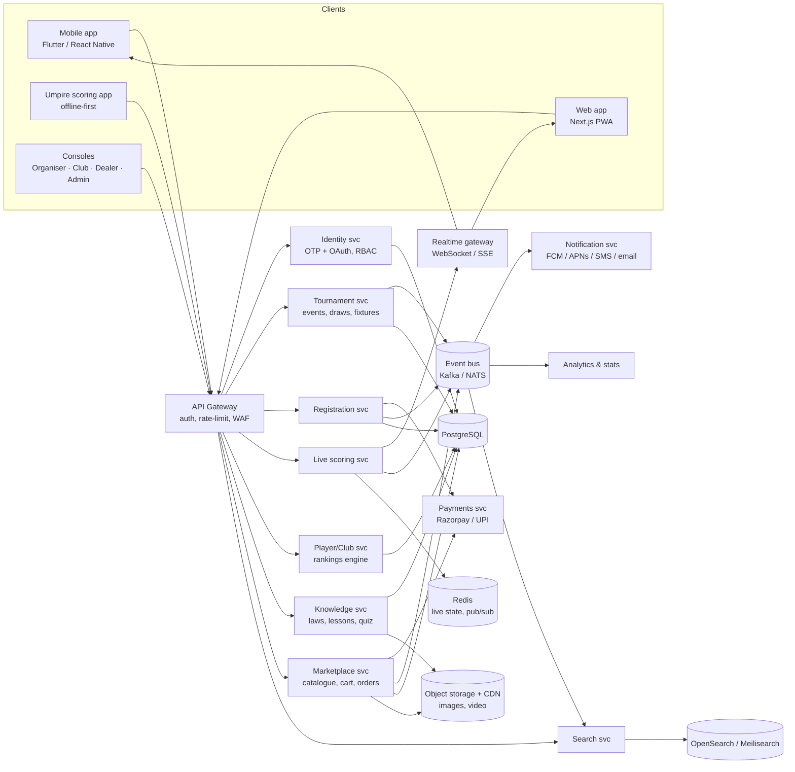
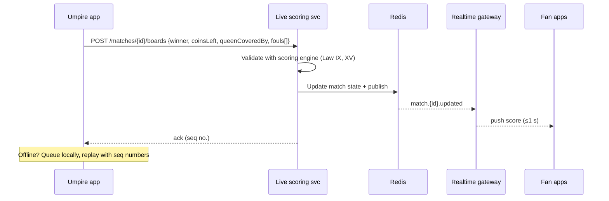

# CarromHub — Product & Technical Architecture

The complete carrom platform: live scores, tournaments & registration, clubs & players, the Laws of Carrom, learning, and a dealer marketplace.

> **Run the prototype:** `npm start` and open http://localhost:3000 (installable as an app; accounts, organiser services and admin need the server). Opening `index.html` directly still works for the read-only parts. Rules are summarised from the [AICF Laws of Carrom](https://www.indiancarrom.co.in/laws-of-carrom/); players, clubs, tournaments and products are demo data. Live scores are simulated every 6 s.

### Environment
| Variable | Purpose |
|---|---|
| `PORT` | Port (default 3000, auto-increments if busy) |
| `HOST`, `ALLOWED_HOSTS` | Serve on the LAN for phones: `HOST=0.0.0.0 ALLOWED_HOSTS=192.168.1.10:3000` |
| `OTP_DELIVERY` | `sms` once an SMS gateway is wired in; otherwise the OTP is shown in-app and logged (dev mode) |
| `ADMIN_KEY` | Secret for scripted / AI updates via `X-Admin-Key` header; without it the first signed-up user becomes admin |

---

## 1. Product design

### 1.1 Personas & roles
| Role (sign-up) | Needs | Key screens |
|---|---|---|
| **Individual player** | Live scores, join organiser events, buy gear, keep score | Home, Events → Request to join, Shop → Buy, Score keeper, My account |
| **Organiser** (office / institute / club) | Host matches & tournaments, approve players, hire boards & umpires | Organiser console (`#/organiser`), Organise-with-us (`#/organise`) |
| **Merchant** | List products, update inventory, fulfil orders | Merchant console (`#/merchant`), Marketplace on Shop |
| **Admin** (assigned; first sign-up) | Moderate requests/partners/content, manage roles | Admin console (`#/admin`), `tools/admin.js`, `X-Admin-Key` |

Umpires, venues and board-hire vendors are listed under **Partners** (service listings) rather than as login roles.

### 1.2 Information architecture
```
Home ─ Live ticker · Live now · Upcoming · Stars · Rule of the day · Headlines
Live ─ Live / Scheduled / Results → Match centre (games, boards, H2H, board feed)
Events ─ Upcoming / Live / Completed, filters (level, category, state, reg. open) → Event → Register → Pay
Players ─ Rankings by category, state & star filters → Player profile (stats, titles, matches, follow)
Clubs ─ Search, state, sort → Club (facilities, star players, roster, join)
Rules ─ Search w/ synonyms · Level (Must-know/Competitive/Umpire) · 12 categories ·
        "What happens if…?" situation finder · Saved laws · Deep links (#/rules?id=XV.1)
Learn ─ Tracks (Beginner → Pro → Umpire) · Lessons linked to laws · Interactive board anatomy · Quiz · Glossary
Shop ─ Category, dealer, price, tournament-spec, sort → Product (spec ↔ law check) → Multi-dealer cart → Checkout
More ─ Score keeper (official scoring engine) · Profile (registrations, orders, follows, saved laws, progress)
```

### 1.3 UX principles
- **Mobile-first**, thumb-reachable bottom nav (7 tabs), desktop top nav.
- **One-tap filters** (chips/tabs) instead of forms; filters persist per session.
- **Rules are actionable**: every lesson, product spec and score screen links back to the exact law.
- **Situation finder** lets players combine what happened in a stroke (e.g. *Striker pocketed + Queen + Improper*) to get only the applicable laws.
- Live elements (ticker, flash on update, follow alerts) mirror professional football apps.

---

## 2. System architecture (production)



### 2.1 Services
| Service | Responsibility | Notes |
|---|---|---|
| Identity | Phone OTP login, roles, KYC for dealers/organisers | JWT (short-lived) + refresh, RBAC per role |
| Tournament | Events, categories, draws (knock-out / league), fixtures, courts | Seeding from ranking points |
| Registration | Entries, eligibility (age/category), waitlists, refunds | Idempotency keys on payment callbacks |
| Live scoring | Board-by-board events from umpire app; derives game/match state | Event-sourced; state cached in Redis |
| Player/Club | Profiles, rosters, star flags, ranking engine | Nightly + on-result recompute |
| Knowledge | Laws (versioned), lessons, quizzes, media | Laws versioned so old matches cite the right edition |
| Marketplace | Multi-dealer catalogue, stock, cart, split orders, payouts | Order split per dealer, commission ledger |
| Payments | Checkout, webhooks, refunds, settlements | Never stores card data (PCI via gateway) |
| Notifications | Follow alerts, reg. deadlines, order status | User-level preferences & quiet hours |
| Search | Unified search, synonyms (red→queen, due→penalty) | Indexed from event bus |

Start as a **modular monolith** (NestJS or Spring Boot) with these as modules and one Postgres; split live scoring and marketplace into services first when load requires.

### 2.2 Live scoring flow


### 2.3 Core data model
```
User(id, phone, name, roles[])            Player(id, user_id, dob, gender, state, club_id, star, style)
Club(id, name, city, state, founded, rating, coach)         Ranking(player_id, category, points, rank, as_of)
Tournament(id, name, level, venue, start, end, reg_deadline, fee, prize, slots, organiser_id, status)
TournamentCategory(id, tournament_id, name, format, age_min, age_max, gender)
Registration(id, category_id, player_id, status, payment_id, created_at)
Match(id, category_id, round, p1, p2, court, status, scheduled_at)
Game(id, match_id, no, score_p1, score_p2)       Board(id, game_id, no, winner, coins_left, queen_by, points, events jsonb)
Law(id, edition, section, category, level, title, text, tags[])     Lesson(id, track, title, body, law_ids[])
Dealer(id, name, verified, kyc_status, rating)    Product(id, dealer_id, category, specs jsonb, price, mrp, stock, tournament_spec)
Order(id, user_id, total, status)  OrderItem(order_id, product_id, dealer_id, qty, price)   Payment(id, ref, amount, status)
```

### 2.4 Key APIs (REST, versioned `/v1`)
```
GET  /tournaments?status=&level=&category=&state=&regOpen=      GET  /tournaments/{id}
POST /tournaments/{id}/registrations                            GET  /me/registrations
GET  /matches?status=live         WS /realtime (subscribe match.{id}, tournament.{id})
POST /matches/{id}/boards        (umpire only)
GET  /players?category=&state=&star=&q=      GET /players/{id}      POST /players/{id}/follow
GET  /clubs?state=&q=&sort=      GET /clubs/{id}
GET  /laws?q=&category=&level=&tags=   GET /laws/{id}      GET /lessons  GET /quiz
GET  /products?category=&dealer=&maxPrice=&spec=&sort=   POST /cart/items   POST /orders
GET  /search?q=
```

---

## 3. Scoring engine (shared by umpire app, score keeper, and server)
- Board winner scores opponent's remaining coins (1 each).
- Queen = 3 pts to the board winner **only while their score ≤ 21**; loser never gets Queen points.
- Max 12 pts per board; dues/penalties written off at board end.
- Game = first to 25 or leader after 8 boards; tie after 8 → extra board (up to pre-quarters).
- Match = best of 3; game 3 side change after board 4 or 13 pts (pre-QF) / 13 pts (QF+).

Implemented client-side in the prototype's score keeper (`js/app.js → scorer`); in production it lives in a shared package used by both client and server so results always agree.

---

## 4. Non-functional requirements
| Area | Target / approach |
|---|---|
| Live latency | < 1 s umpire → fan via Redis pub/sub + WebSocket; SSE fallback |
| Scale | Stateless API pods behind autoscaling; CDN for static/media; read replicas for rankings |
| Offline | Umpire app queues board events locally; fan app caches last state |
| Security | OWASP ASVS L2, TLS everywhere, OTP rate-limits, RBAC, input validation server-side, CSP, encrypted PII, audit logs on score edits |
| Payments | Gateway-hosted checkout, signed webhooks, idempotent order creation |
| Privacy | Minors' data (juniors) requires guardian consent; DPDP Act compliance |
| Observability | OpenTelemetry traces, Prometheus/Grafana, Sentry |
| Accessibility | WCAG 2.1 AA, large tap targets, screen-reader labels |
| i18n | English, Hindi, Marathi, Tamil, Bengali, Telugu… |

---

## 5. Roadmap
1. **MVP** — Rules, Learn, Events listing, Registration + payments, Rankings, Clubs, static Shop with dealer enquiries.
2. **Live** — Umpire scoring app, realtime match centre, follow alerts, brackets.
3. **Marketplace** — Dealer onboarding/KYC, multi-dealer cart, order tracking, reviews.
4. **Growth** — Video lessons & streams, coach booking, club leagues, fantasy/predictions, AI shot analysis from video.

## 5a. Launch checklist
| Step | How |
|---|---|
| Local network (today) | `HOST=0.0.0.0 ALLOWED_HOSTS=<your-ip>:3000 npm start` → phones on the same Wi-Fi open `http://<your-ip>:3000` |
| Public, zero-ops | Push to GitHub → Render “Blueprint” from `render.yaml` (free tier + 1 GB disk) → custom domain → HTTPS automatic |
| Public, Fly.io | `fly launch --copy-config --no-deploy` · `fly volumes create carrom_data -s 1 -r bom` · `fly deploy` |
| Own VPS | Copy `.env.example` → `.env` (set `DOMAIN`) · `docker compose up -d` (Caddy terminates HTTPS) |
| OTP by SMS | Set `OTP_DELIVERY=sms` and `SMS_WEBHOOK_URL` (+ `SMS_WEBHOOK_KEY`) to any gateway/relay that accepts `POST {to, message}` — MSG91, Fast2SMS, Twilio via a 10-line function |
| Admin | First sign-up becomes admin; set `ADMIN_KEY` for CLI/AI updates (`node tools/admin.js`, `X-Admin-Key`) |
| App install | Works automatically over HTTPS (Chrome/Edge “Install app”, iOS “Add to Home Screen”); plain-HTTP LAN shows the site but not the install prompt |
| Before real money | Plug a payment gateway into registration/checkout (currently demo), add Terms/Privacy pages, nightly `data/` backup |

---

## 6. Prototype file map
```
index.html            App shell (inline SVG icon sprite, top nav, search w/ suggestions, ticker, bottom nav, PWA meta)
manifest.webmanifest  Installable app manifest (shortcuts: Live, Scorer, Laws, Organise)
sw.js                 Service worker: app-shell cache, API always network
icons/                SVG app icons (any + maskable)
css/styles.css        Design tokens (dark + light themes), Inter/Plus Jakarta type, components
js/data/rules.js      Laws of Carrom: 12 categories, 3 levels, situation tags
js/data/mock.js       Demo players, clubs, tournaments, matches, dealers, products, lessons, quiz
js/data/bodies.js     Governing-bodies directory (ICF, confederations, national federations, Indian
                      states, institutional boards) + World Championship 2026 details — verified links only
js/app.js             Hash router, views, filters, cart, registration, live simulation, score keeper,
                      head-to-head compare, theme toggle, search autocomplete, share / calendar export,
                      community clubs, login (phone + OTP), Organise-a-tournament, Partners, Admin console
server.js             Node http server: static files, legacy demo API, platform API (/api/auth, /api/me,
                      /api/requests, /api/vendors, /api/content, /api/users), X-Admin-Key support
database.js           node:sqlite service layer: users/OTP/sessions, service_requests, vendors, content,
                      events + event_joins (organiser approvals), listings + orders (merchant inventory),
                      plus the original results/challenges demo
tools/admin.js        CLI for humans or AI assistants: export/import/set content, verify partners,
                      update request status, manage roles — works directly on data/carrom.sqlite
tests/                node:test suites for the service layer (npm test)
```

### Organiser services flow
```mermaid
sequenceDiagram
  participant O as Office / institute
  participant CH as CarromHub
  participant A as Admin (or AI via CLI / X-Admin-Key)
  participant P as Partners (boards, umpires, scoring, venue)
  O->>CH: Sign in (phone + OTP) · POST /api/requests
  CH-->>O: REQ id + suggested partners (by service & state)
  A->>CH: PATCH /api/requests/:id {status: matching, vendor_ids, admin_note}
  P-->>A: Quotes (off-platform today; partner portal next)
  A->>CH: status quoted → confirmed → completed
  O->>CH: Track status timeline on #/organise
```
